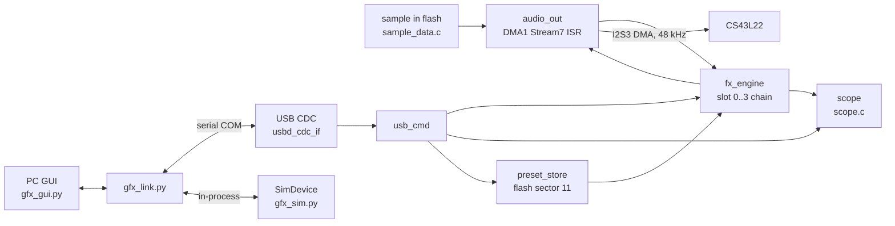

**English** | [Tiếng Việt](architecture.vi.md)

# Architecture

## Overview

Not on this diagram: the user button and LEDs (`main.c`), which call `audio_set_playing()` and `usb_cmd_looper_rec()`.

## Current code structure (M1)
| File | Responsibility |
|---|---|
| `firmware/Core/Src/main.c` | init, main loop, button (short = play/stop, long = looper record), LEDs, `Error_Handler` |
| `firmware/Core/Src/audio_out.c` | PLLI2S, I2S3, circular DMA ping-pong, codec init, renders each half via `fx_process()`, CPU % and peak meters |
| `firmware/Core/Src/fx_engine.c` | 4-slot chain, arenas, CPU budget, structural-change handoff to the ISR, tails |
| `firmware/Core/Src/fx_algo_registry.c` | builds the algorithm table from `fx_algo_table.h` + descriptors; registry is automatic |
| `firmware/Core/Src/fx_params.c` | global parameters (`bypass`, `in.level`, `out.level`) |
| `firmware/Core/Src/algos/algo_*.c` | algorithms: `delay`, `dyn`, `looper`, `mod`, `pitch`, `reverb` (each ends with its `fx_algo_t` descriptor) |
| `firmware/Core/Src/usb_cmd.c` | ASCII parser for the CDC link, streamed replies, looper/preset commands |
| `firmware/Core/Src/scope.c` (+ `scope.h`) | waveform capture in the audio ISR: 256 points x min/max x 3 channels, window/trigger logic, mu-law storage (1536 B) |
| `firmware/Core/Inc/dsp_util.h` | shared DSP helpers incl. G.711 mu-law encode/decode (used by looper and scope) |
| `firmware/Core/Src/preset_store.c` | 16 presets in sector 11, CRC image + current-index marker log |
| `firmware/Core/Src/sample_data.c` | generated test sample (`tools/make_sample.py`) |
| `firmware/USB_DEVICE/` | USB CDC-ACM device (byte rings, `CDC_IsConfigured()`) |
| `tools/gfx_link.py` | protocol client (serial + simulator transports), parses `fx_algo_table.h` |
| `tools/gfx_sim.py` | `SimDevice`: firmware-equivalent device model for GUI and tests |
| `tools/gfx_gui.py`, `tools/gfx_widgets.py` | Tk pedal GUI and custom widgets (knobs, chain strip, meters) |
| `tools/gfx_scope.py` | Scope window (waveform viewer) |
| `firmware/test/host/` | PC test harness and suites ([testing](testing.md)) |

### Algorithm catalogue
Source of truth: [fx_algo_table.h](../firmware/Core/Inc/fx_algo_table.h) (ids, names, categories, parameters). `cost` = worst-case cycles per stereo frame (estimate; see [testing](testing.md#cpu-measurements)), from the descriptors.

| Category | Algorithms (id: cost) |
|---|---|
| Delay | 1 Digital Delay: 200, 2 Tape Echo: 260, 3 Mod Delay: 220, 4 Ping-Pong: 300, 5 Reverse Delay: 150 |
| Modulation | 6 Chorus: 260, 7 Vibrato: 170, 8 Flanger: 330, 9 Phaser: 420, 10 Tremolo/Pan: 110, 11 Rotary: 480, 12 Ring Mod: 130 |
| Pitch | 13 Octaver: 650, 14 Harmonizer: 450, 15 Detune: 420 |
| Reverb | 16 Room: 640, 17 Hall: 690, 18 Plate: 670, 19 Spring: 330, 20 Shimmer: 780 |
| Drive/Dynamics | 21 Overdrive: 260, 22 Fuzz: 240, 23 Bit Crusher: 70, 24 Compressor: 200, 25 Auto-Wah: 240, 26 EQ: 170 |
| Looper | 27 Looper: 150 (takes the remaining arena, min 24000 B = 1 s) |

Id 0 is Empty. Ids are stored in presets: never renumber, only append.

### Memory map
| Region | Size | Contents |
|---|---|---|
| ROM (linker limit) | 896 KB | code + sample (~576 KB); sector 11 (`0x080E0000`, 128 KB) reserved for presets |
| RAM | 128 KB | `.data/.bss`, SRAM arena 88 KB (`ARENA_SRAM_BYTES`), stacks, USB rings, per-slot state (`FX_STATE_BYTES` = 2048 B x 4) |
| CCMRAM | 64 KB | CCM arena 62 KB (`ARENA_CCM_BYTES`), CPU-only (no DMA), cleared by `fx_init()` |
| Arenas total | 153.6 KB | default chain uses ~115 KB (114928 B measured via `STATUS`) |

Build report (2026-11-12, with Scope): ROM 683004 B (74.4 %), RAM 122976 B (93.82 %), CCMRAM 62 KB (96.9 %).

### Concurrency model
| Context | Runs | Rules |
|---|---|---|
| Audio DMA ISR (DMA1 Stream7 half/full transfer) | `fx_process()`, all algorithm `init/update/process/command` | owns all DSP state; applies structural requests at block start |
| Main loop | `usb_cmd`, button, LEDs, presets, `get_status()` | parameter writes store a clamped value + dirty flag consumed next block; structural calls (assign, move, apply_config, defaults) are validated (arenas + CPU budget) then handed to the ISR and return once applied |
| USB interrupt | byte rings in `usbd_cdc_if.c` | only queue bytes |

`get_status()` may only read atomically written (aligned 32-bit) fields. Flash save mutes audio (`audio_set_muted`) since the erase stalls the CPU.

### Data flow
1. Sample (mono int16) is read by the DMA ISR, scaled by `in.level`, and processed in 256-frame blocks (`FX_BLOCK_FRAMES`) through slots 0..3, then `out.level`, then int16 stereo into the I2S ping-pong half.
2. After `fx_process()` the ISR feeds `scope.c` with the dry source (`in`) and the output (`l`, `r`).
3. `bypass = 1` crossfades the whole chain to the dry input x `out.level`.
4. Commands arrive over CDC, are parsed in the main loop and applied to `fx_engine` / `preset_store`.

## Architecture decisions

### D1 — Custom I2S/DMA output instead of the BSP audio driver
- **Why:** the BSP audio driver runs DMA in `DMA_NORMAL` mode and pulls in the PDM library; gapless streaming needs circular mode. Codec control still uses the BSP `cs43l22` component and `AUDIO_IO_*`.
- **Alternatives considered:** BSP audio driver with re-arming in the transfer-complete callback.
- **Trade-off:** own PLLI2S/I2S/DMA code to maintain.

### D2 — Makefile project instead of a CubeMX-generated `.ioc`
- **Why:** reproducible command-line build with the CubeIDE-bundled toolchain; no generator overwriting hand-written code. The project is importable into CubeIDE as a Makefile project ([development](development.md#4-debugging)).
- **Alternatives considered:** CubeMX/CubeIDE managed project.
- **Trade-off:** peripheral setup is written by hand.

### D3 — X-macro catalogue `fx_algo_table.h` as the single source of truth
- **Why:** one file defines ids, names, categories and parameters; the firmware registry, `ALGOS` command and presets use it, and `tools/gfx_link.py` parses it with a regex so the simulator never drifts. One entry per line is required. A Python test (`test_algos_match_header`) checks the match.
- **Alternatives considered:** separate tables per side; generated code.
- **Trade-off:** parser depends on the line layout; ids are append-only.

### D4 — Memory arenas with best-fit placement and a CPU budget
- **Why:** slots can hold any algorithm, so buffers are placed at assignment time in two arenas (SRAM 88 KB, CCM 62 KB) by best fit; `FX_MEM_REST` (looper) takes the largest block left. A chain is rejected with `ERR memory` or `ERR cpu` (budget 2400 cycles/frame including 250 overhead = 68.6 % of 3500) before touching the running chain. Chorus (off) still counts toward the cost.
- **Alternatives considered:** fixed per-slot buffers; no admission control.
- **Trade-off:** costs are estimates, so the budget is conservative (worst measured 58 % at cost 2100).

### D5 — Tails semantics
- **Why:** an algorithm with `tails = 1` outputs `dry*(1-mix) + wet`, so feeding zeros yields only the tail; when its slot is switched off (or `STOP` mutes the source) the chain keeps feeding it silence until the tail rings out instead of cutting it.
- **Alternatives considered:** hard cut on off.
- **Trade-off:** disabled tail slots still cost CPU while ringing.

### D6 — Looper stored as 8-bit mu-law at 24 kHz mono
- **Why:** RAM. Record = mono sum, 3-tap low-pass, 2:1 decimation, G.711 mu-law; about 1 byte per 2 input frames gives a long loop in the remaining arena (3.75 s with Overdrive alongside, measured capacity 180224 samples at 48 kHz scale).
- **Alternatives considered:** 16-bit at 48 kHz (about 4x less time).
- **Trade-off:** reduced bandwidth (about 12 kHz) and mu-law noise; quality not yet judged on hardware.

### D7 — ASCII line protocol over CDC
- **Why:** debuggable from any serial terminal, trivially parsed in Python, unknown `EVT` lines can be ignored for forward compatibility. See [protocol](protocol.md).
- **Alternatives considered:** binary framing, MIDI SysEx.
- **Trade-off:** larger messages (63-char line limit).

### D8 — 48 kHz mono-sum buffers with stereo output
- **Why:** delay, reverb and pitch effects sum the input to mono for their buffer and generate stereo output, so large buffers are not doubled. Mono-natured effects (drive, EQ, compressor) keep independent L/R state.
- **Alternatives considered:** stereo buffers everywhere.
- **Trade-off:** no true stereo input processing in buffered effects (input is mono today anyway).

### D9 — Streamed USB replies
- **Why:** `ALGOS`, `STATE`, `PLIST` and slot value replies are long; `usb_cmd.c` produces one line per step (`job_t`) so the 2048-byte TX ring never overruns.
- **Alternatives considered:** a reply buffer big enough for the longest reply (does not fit RAM budget).
- **Trade-off:** reply generation is a small state machine.

### D10 — Preset current-index marker log
- **Why:** sector 11 holds a CRC-protected image (header + 16 entries) followed by an append-only log of "current preset" markers, so `PLOAD` persists the choice without erasing flash. Only `PSAVE`/`PDEL` rewrite the sector (audio mute + USB pause ~1-2 s; measured `PSAVE` 1.02 s incl. reply).
- **Alternatives considered:** erase on every load.
- **Trade-off:** marker log fills the free space of the sector until the next rewrite.

### D11 — Scope capture as mu-law min/max in the audio ISR
- **Why:** `scope.c` captures 256 points x min/max x 3 channels (`in`, `l`, `r`) right after `fx_process()` and stores G.711 mu-law bytes: 1536 B of RAM in total, and mu-law keeps -60 dB tails visible. Min/max over `decim = round(window_ms * 48 / 256)` samples preserves peaks when decimating (window 5-5000 ms). Optional trigger on a rising zero crossing of `in` (+-0.02 FS hysteresis), free-run after max(50 ms, window). The host polls `SCOPEDATA` ([protocol](protocol.md#scope-waveform-capture)).
- **Alternatives considered:** raw int16 ring buffer (RAM: far more than 1.5 KB for the same coverage); streaming continuously over USB (bandwidth and ISR load).
- **Trade-off:** 8-bit resolution (mu-law) and polled snapshots instead of a live stream; mu-law encode/decode moved to `dsp_util.h` to share with the looper.
