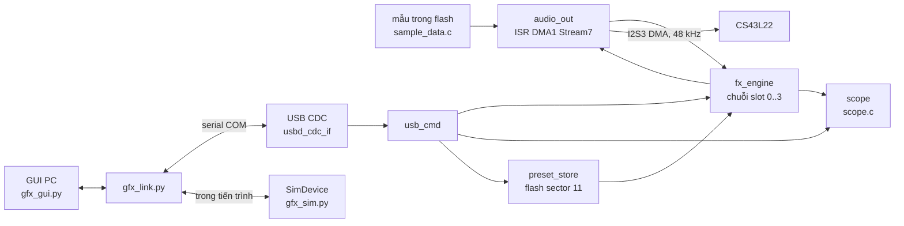

[English](architecture.md) | **Tiếng Việt**

# Kiến trúc

## Tổng quan

Không có trong sơ đồ: nút nhấn người dùng và LED (`main.c`), gọi `audio_set_playing()` và `usb_cmd_looper_rec()`.

## Cấu trúc mã hiện tại (M1)
| File | Trách nhiệm |
|---|---|
| `firmware/Core/Src/main.c` | khởi tạo, vòng lặp chính, nút nhấn (ngắn = play/stop, giữ = looper ghi), LED, `Error_Handler` |
| `firmware/Core/Src/audio_out.c` | PLLI2S, I2S3, DMA circular ping-pong, khởi tạo codec, render mỗi nửa buffer qua `fx_process()`, đo CPU % và peak |
| `firmware/Core/Src/fx_engine.c` | chuỗi 4 slot, arena, ngân sách CPU, chuyển thay đổi cấu trúc cho ISR, tails |
| `firmware/Core/Src/fx_algo_registry.c` | dựng bảng thuật toán từ `fx_algo_table.h` + descriptor; registry tự động |
| `firmware/Core/Src/fx_params.c` | tham số global (`bypass`, `in.level`, `out.level`) |
| `firmware/Core/Src/algos/algo_*.c` | thuật toán: `delay`, `dyn`, `looper`, `mod`, `pitch`, `reverb` (mỗi file kết thúc bằng descriptor `fx_algo_t`) |
| `firmware/Core/Src/usb_cmd.c` | bộ phân tích ASCII cho đường CDC, phản hồi dạng streaming, lệnh looper/preset |
| `firmware/Core/Src/scope.c` (+ `scope.h`) | bắt dạng sóng trong ISR audio: 256 điểm x min/max x 3 kênh, logic cửa sổ/trigger, lưu mu-law (1536 B) |
| `firmware/Core/Inc/dsp_util.h` | hàm DSP dùng chung gồm mã hóa/giải mã G.711 mu-law (looper và scope dùng) |
| `firmware/Core/Src/preset_store.c` | 16 preset trong sector 11, ảnh có CRC + log marker chỉ số hiện tại |
| `firmware/Core/Src/sample_data.c` | mẫu thử được sinh tự động (`tools/make_sample.py`) |
| `firmware/USB_DEVICE/` | thiết bị USB CDC-ACM (ring byte, `CDC_IsConfigured()`) |
| `tools/gfx_link.py` | client giao thức (transport serial + simulator), phân tích `fx_algo_table.h` |
| `tools/gfx_sim.py` | `SimDevice`: mô hình thiết bị tương đương firmware cho GUI và test |
| `tools/gfx_gui.py`, `tools/gfx_widgets.py` | GUI Tk kiểu pedal và widget tự vẽ (núm, chain strip, meter) |
| `tools/gfx_scope.py` | cửa sổ Scope (xem dạng sóng) |
| `firmware/test/host/` | khung test trên PC và các suite ([testing](testing.vi.md)) |

### Catalogue thuật toán
Nguồn chuẩn: [fx_algo_table.h](../firmware/Core/Inc/fx_algo_table.h) (id, tên, nhóm, tham số). `cost` = số cycle tệ nhất mỗi frame stereo (ước lượng; xem [testing](testing.vi.md#đo-cpu)), lấy từ các descriptor.

| Nhóm | Thuật toán (id: cost) |
|---|---|
| Delay | 1 Digital Delay: 200, 2 Tape Echo: 260, 3 Mod Delay: 220, 4 Ping-Pong: 300, 5 Reverse Delay: 150 |
| Modulation | 6 Chorus: 260, 7 Vibrato: 170, 8 Flanger: 330, 9 Phaser: 420, 10 Tremolo/Pan: 110, 11 Rotary: 480, 12 Ring Mod: 130 |
| Pitch | 13 Octaver: 650, 14 Harmonizer: 450, 15 Detune: 420 |
| Reverb | 16 Room: 640, 17 Hall: 690, 18 Plate: 670, 19 Spring: 330, 20 Shimmer: 780 |
| Drive/Dynamics | 21 Overdrive: 260, 22 Fuzz: 240, 23 Bit Crusher: 70, 24 Compressor: 200, 25 Auto-Wah: 240, 26 EQ: 170 |
| Looper | 27 Looper: 150 (lấy phần arena còn lại, tối thiểu 24000 B = 1 s) |

Id 0 là Empty. Id được lưu trong preset: không bao giờ đánh số lại, chỉ thêm vào cuối.

### Bản đồ bộ nhớ
| Vùng | Kích thước | Nội dung |
|---|---|---|
| ROM (giới hạn linker) | 896 KB | mã + mẫu (~576 KB); sector 11 (`0x080E0000`, 128 KB) dành cho preset |
| RAM | 128 KB | `.data/.bss`, arena SRAM 88 KB (`ARENA_SRAM_BYTES`), stack, ring USB, state mỗi slot (`FX_STATE_BYTES` = 2048 B x 4) |
| CCMRAM | 64 KB | arena CCM 62 KB (`ARENA_CCM_BYTES`), chỉ CPU truy cập (không DMA), được `fx_init()` xóa |
| Tổng arena | 153.6 KB | chuỗi mặc định dùng ~115 KB (114928 B đo qua `STATUS`) |

Báo cáo build (12/11/2026, có Scope): ROM 683004 B (74.4 %), RAM 122976 B (93.82 %), CCMRAM 62 KB (96.9 %).

### Mô hình đồng thời
| Ngữ cảnh | Chạy | Quy tắc |
|---|---|---|
| ISR audio DMA (DMA1 Stream7 half/full transfer) | `fx_process()`, mọi `init/update/process/command` của thuật toán | sở hữu toàn bộ state DSP; áp dụng yêu cầu thay đổi cấu trúc ở đầu block |
| Vòng lặp chính | `usb_cmd`, nút nhấn, LED, preset, `get_status()` | ghi tham số lưu giá trị đã kẹp + cờ dirty, block kế tiếp xử lý; lời gọi thay đổi cấu trúc (assign, move, apply_config, defaults) được kiểm tra (arena + ngân sách CPU) rồi chuyển cho ISR và trả về khi đã áp dụng |
| Ngắt USB | ring byte trong `usbd_cdc_if.c` | chỉ xếp hàng byte |

`get_status()` chỉ được đọc các trường ghi nguyên tử (32-bit căn chỉnh). Lưu flash tắt tiếng audio (`audio_set_muted`) vì thao tác xóa làm đứng CPU.

### Luồng dữ liệu
1. Mẫu (mono int16) được ISR DMA đọc, nhân `in.level`, xử lý theo block 256 frame (`FX_BLOCK_FRAMES`) qua slot 0..3, rồi `out.level`, rồi int16 stereo vào nửa ping-pong của I2S.
2. Sau `fx_process()` ISR đưa nguồn dry (`in`) và đầu ra (`l`, `r`) cho `scope.c`.
3. `bypass = 1` crossfade cả chuỗi sang tín hiệu dry đầu vào x `out.level`.
4. Lệnh đến qua CDC, được phân tích ở vòng lặp chính và áp dụng vào `fx_engine` / `preset_store`.

## Quyết định kiến trúc

### D1 — Tự viết I2S/DMA output thay vì driver audio của BSP
- **Lý do:** driver audio BSP chạy DMA ở chế độ `DMA_NORMAL` và kéo theo thư viện PDM; phát liên tục không gián đoạn cần chế độ circular. Điều khiển codec vẫn dùng component `cs43l22` của BSP và `AUDIO_IO_*`.
- **Phương án khác đã xem:** driver audio BSP với việc nạp lại trong callback transfer-complete.
- **Đánh đổi:** phải tự bảo trì mã PLLI2S/I2S/DMA.

### D2 — Dự án Makefile thay vì `.ioc` do CubeMX sinh
- **Lý do:** build dòng lệnh tái lập được với toolchain đi kèm CubeIDE; không có bộ sinh mã ghi đè mã viết tay. Dự án import được vào CubeIDE như Makefile project ([development](development.vi.md#4-gỡ-lỗi)).
- **Phương án khác đã xem:** dự án do CubeMX/CubeIDE quản lý.
- **Đánh đổi:** cấu hình ngoại vi viết tay.

### D3 — Catalogue X-macro `fx_algo_table.h` là nguồn chuẩn duy nhất
- **Lý do:** một file định nghĩa id, tên, nhóm và tham số; registry firmware, lệnh `ALGOS` và preset đều dùng nó, còn `tools/gfx_link.py` phân tích bằng regex nên simulator không bao giờ lệch. Bắt buộc mỗi mục một dòng. Test Python (`test_algos_match_header`) kiểm tra sự khớp.
- **Phương án khác đã xem:** bảng riêng mỗi phía; sinh mã.
- **Đánh đổi:** bộ phân tích phụ thuộc bố cục dòng; id chỉ được thêm vào cuối.

### D4 — Arena bộ nhớ với đặt best-fit và ngân sách CPU
- **Lý do:** slot có thể chứa thuật toán bất kỳ nên buffer được đặt lúc gán vào hai arena (SRAM 88 KB, CCM 62 KB) theo best-fit; `FX_MEM_REST` (looper) lấy khối lớn nhất còn lại. Chuỗi bị từ chối bằng `ERR memory` hoặc `ERR cpu` (ngân sách 2400 cycle/frame gồm 250 overhead = 68.6 % của 3500) trước khi động đến chuỗi đang chạy. Chorus (đang off) vẫn tính vào cost.
- **Phương án khác đã xem:** buffer cố định mỗi slot; không kiểm soát nạp.
- **Đánh đổi:** cost là ước lượng nên ngân sách bảo thủ (đo tệ nhất 58 % ở cost 2100).

### D5 — Ngữ nghĩa tails
- **Lý do:** thuật toán có `tails = 1` xuất `dry*(1-mix) + wet`, nên đưa vào số 0 chỉ còn phần đuôi; khi slot bị tắt (hoặc `STOP` tắt tiếng nguồn) chuỗi tiếp tục đưa im lặng cho nó đến khi đuôi tắt hẳn thay vì cắt đột ngột.
- **Phương án khác đã xem:** cắt cứng khi tắt.
- **Đánh đổi:** slot đã tắt nhưng đang ngân vẫn tốn CPU.

### D6 — Looper lưu mu-law 8-bit, 24 kHz mono
- **Lý do:** RAM. Ghi = tổng mono, lọc thông thấp 3 tap, decimate 2:1, mu-law G.711; khoảng 1 byte cho 2 frame đầu vào cho vòng loop dài trong phần arena còn lại (3.75 s khi có Overdrive cùng chuỗi, dung lượng đo được 180224 sample theo thang 48 kHz).
- **Phương án khác đã xem:** 16-bit ở 48 kHz (thời gian ngắn hơn khoảng 4 lần).
- **Đánh đổi:** băng thông giảm (khoảng 12 kHz) và nhiễu mu-law; chưa đánh giá chất lượng trên phần cứng.

### D7 — Giao thức dòng ASCII qua CDC
- **Lý do:** gỡ lỗi được từ mọi terminal serial, phân tích dễ trong Python, dòng `EVT` lạ có thể bỏ qua để tương thích về sau. Xem [protocol](protocol.vi.md).
- **Phương án khác đã xem:** đóng khung nhị phân, MIDI SysEx.
- **Đánh đổi:** thông điệp dài hơn (giới hạn dòng 63 ký tự).

### D8 — Buffer tổng mono 48 kHz với đầu ra stereo
- **Lý do:** hiệu ứng delay, reverb và pitch cộng đầu vào thành mono cho buffer của chúng và tạo đầu ra stereo, nên buffer lớn không bị nhân đôi. Hiệu ứng bản chất mono (drive, EQ, compressor) giữ state L/R độc lập.
- **Phương án khác đã xem:** buffer stereo ở mọi nơi.
- **Đánh đổi:** không xử lý đầu vào stereo thật trong các hiệu ứng có buffer (hiện đầu vào vốn là mono).

### D9 — Phản hồi USB dạng streaming
- **Lý do:** phản hồi của `ALGOS`, `STATE`, `PLIST` và giá trị slot rất dài; `usb_cmd.c` tạo mỗi bước một dòng (`job_t`) nên ring TX 2048 byte không bao giờ tràn.
- **Phương án khác đã xem:** buffer phản hồi đủ lớn cho phản hồi dài nhất (không vừa ngân sách RAM).
- **Đánh đổi:** việc tạo phản hồi là một state machine nhỏ.

### D10 — Log marker chỉ số preset hiện tại
- **Lý do:** sector 11 chứa ảnh có CRC (header + 16 mục) theo sau là log chỉ-thêm các marker "preset hiện tại", nên `PLOAD` lưu được lựa chọn mà không xóa flash. Chỉ `PSAVE`/`PDEL` ghi lại sector (tắt tiếng + USB tạm dừng ~1-2 s; đo `PSAVE` 1.02 s gồm cả phản hồi).
- **Phương án khác đã xem:** xóa mỗi lần nạp.
- **Đánh đổi:** log marker lấp dần vùng trống của sector cho đến lần ghi lại kế tiếp.

### D11 — Bắt Scope dạng min/max mu-law trong ISR audio
- **Lý do:** `scope.c` bắt 256 điểm x min/max x 3 kênh (`in`, `l`, `r`) ngay sau `fx_process()` và lưu byte mu-law G.711: tổng cộng 1536 B RAM, và mu-law giữ cho đuôi -60 dB vẫn nhìn thấy. Min/max trên `decim = round(window_ms * 48 / 256)` sample giữ được đỉnh khi decimate (cửa sổ 5-5000 ms). Trigger tùy chọn ở điểm cắt zero đi lên của `in` (trễ +-0.02 FS), free-run sau max(50 ms, cửa sổ). Host poll `SCOPEDATA` ([protocol](protocol.vi.md#scope-bắt-dạng-sóng)).
- **Phương án khác đã xem:** ring buffer int16 thô (RAM: nhiều hơn 1.5 KB rất nhiều cho cùng độ phủ); stream liên tục qua USB (băng thông và tải ISR).
- **Đánh đổi:** độ phân giải 8-bit (mu-law) và snapshot poll thay vì luồng trực tiếp; mu-law encode/decode chuyển sang `dsp_util.h` để dùng chung với looper.
