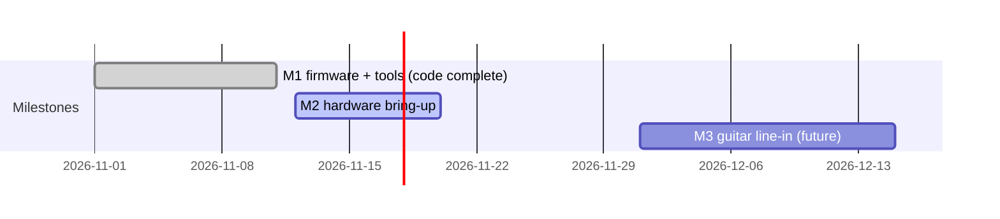

**English** | [Tiếng Việt](plan-roadmap.vi.md)

# Plan, Roadmap and Timeline

> Updated: 2026-11-12 · Status: **M1 code complete**, **M2** (hardware bring-up) in progress

## 1. Product goals

| Metric | Target | Status |
|---|---|---|
| Effect slots in series | 4 | done (host-tested) |
| Algorithms | 27 (+ Empty) | done (host-tested) |
| Output | 48 kHz / 16-bit stereo via CS43L22 | audible through the headphone jack (user report, no quality measurement) |
| CPU budget | 2400 cycles per frame (68.6 % of 3500) | worst measured 58 % ([testing](testing.md#cpu-measurements)) |
| Presets | 16 in flash | save/load/delete verified over protocol; GUI save survives power cycle (user report) |
| Control | USB CDC protocol v2 + pedal-style GUI | protocol verified on board; preset save from GUI confirmed by user, other GUI functions preliminary |

Roles: the Discovery board is the DSP engine; the PC GUI is the control surface (the board has one button).

## 2. Scope

**In scope (M1-M2):** test-sample source from flash, 4-slot chain, looper, presets, USB control, GUI, simulator, host tests.

**Out of scope for now:** guitar line input (M3, future), standalone control surface (knobs/footswitches), MIDI.

## 3. Timeline

| Milestone | Dates | Main result |
|---|---|---|
| M1 | to 2026-11-11 | firmware + tools code complete, host tests pass |
| M2 | from 2026-11-12 | firmware verified on the board |
| M3 | not scheduled | guitar input (needs hardware) |

The M1 start date and the M2/M3 end/start dates are planning placeholders, not recorded history.

## 4. Milestone details

### M1 — Firmware + tools (code complete)
- [x] 2026-11-12: host tests pass, 7 suites (`test_chain`: 15129 checks, 0 failed)
- [x] 2026-11-12: Python unit tests (19, now 24 with Scope) pass; GUI `--selftest` passes against the simulator
- [x] 2026-11-12: firmware builds with zero warnings; ROM 681280 B / 896 KB (74.25 %), RAM 121384 B / 128 KB (92.61 %), CCMRAM 62 KB / 64 KB (96.88 %)
- [ ] GUI viewed by a human (the user has used it with the board; the Scope window has never been viewed by a human)
- [x] 2026-11-12: Scope (waveform viewer) added: firmware `scope.c`, protocol `SCOPE`/`SCOPEDATA`, GUI `gfx_scope.py`; Python tests 24 pass, GUI selftest passes; ROM 683004 B (74.4 %), RAM 122976 B (93.82 %)

### M2 — Hardware bring-up (in progress)
Verification status is recorded in [hardware](hardware.md#verification-status); procedures in [testing](testing.md).
- [x] 2026-11-12: flashed via ST-LINK, "Download verified successfully"
- [x] 2026-11-12: firmware runs (no error handler), green LED on, I2S3 TX DMA circular with NDTR changing, blue LED blinking while USB not connected (SWD register reads)
- [x] 2026-11-12: USB enumerates as "USB Serial Device (COM13)", VID `0x0483` PID `0x5740`, inbox driver
- [x] 2026-11-12: protocol v2 smoke test over COM13 (discovery, editing, errors, looper, presets)
- [x] 2026-11-12: CPU load measured on 7 chains (12-58 %)
- [x] 2026-11-12: audible output through the headphone jack (user report, no quality measurement)
- [x] 2026-11-12: preset saved from the GUI survives a power cycle (user report)
- [ ] Other GUI functions on the real board (preliminary: implied by the preset save)
- [x] 2026-11-12: Scope capture over USB (scripts: 20 ms triggered ready after 0.20 s, 2000 ms free-run after 2.07 s; `gfx_link.Connection` on COM13: 256 points per channel)
- [ ] Scope window viewed by a human
- [ ] Button: short press play/stop, long press looper record
- [ ] Looper recording audible/quality check (protocol states verified, audio not)
- [ ] Confirm LED behavior (clip, bypass, rec blink)

Exit criteria:
- clean output through the codec on all 7 tested chains without dropouts (audible confirmed by the user; per-chain check pending)
- GUI controls the board for a full session (edit, save, load, looper)
- no chain accepted by the engine exceeds 100 % measured CPU

### M3 — Guitar line-in (future, non-goal now)
The CS43L22 is output-only. A guitar input needs an external ADC/codec input stage (instrument-level buffer, anti-alias filter, ADC on I2S or a codec with input) and firmware to feed `fx_process()` from it instead of the flash sample. Not designed or scheduled.

## 5. Risks

| Risk | Impact | Mitigation |
|---|---|---|
| RAM 93.8 % full (CCMRAM 96.9 %) | little room for features; looper capacity shrinks when other slots use arenas | arenas with best-fit placement, `ERR memory` on overflow; measure before adding |
| CPU cost values are estimates | a heavy chain might overrun the block period | measured: worst 58 % at cost 2100; budget 2400 = 68.6 %; re-measure when adding algorithms (short measurement window, pitch re-alignment spikes may be missed) |
| mu-law 24 kHz looper quality | audible noise/bandwidth limit (about 12 kHz) | not yet listened to on hardware; capacity 3.75 s with Overdrive alongside |
| Flash save stalls audio/USB for ~1-2 s | dropout during save | audio muted around erase; measured save call 1.02 s incl. reply |
| No guitar input | cannot be used with a guitar yet | M3 |

## 6. Keeping this document up to date
Tick checkboxes only after the test ran, with date and evidence. Record measurements in [testing](testing.md) with raw data in `docs/measurements/`, hardware facts in [hardware](hardware.md), and mirror user-visible progress in the README status line and the CHANGELOG. Update both languages together.
