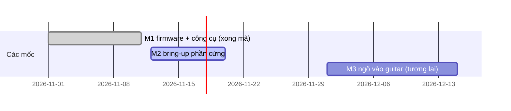

[English](plan-roadmap.md) | **Tiếng Việt**

# Kế hoạch, Roadmap và Timeline

> Cập nhật: 12/11/2026 · Trạng thái: **M1 đã viết xong mã**, **M2** (bring-up phần cứng) đang tiến hành

## 1. Mục tiêu sản phẩm

| Chỉ số | Mục tiêu | Trạng thái |
|---|---|---|
| Số slot hiệu ứng nối tiếp | 4 | xong (đã host test) |
| Thuật toán | 27 (+ Empty) | xong (đã host test) |
| Đầu ra | 48 kHz / 16-bit stereo qua CS43L22 | nghe được qua jack tai nghe (báo cáo người dùng, không có số đo chất lượng) |
| Ngân sách CPU | 2400 cycle mỗi frame (68.6 % của 3500) | đo tệ nhất 58 % ([testing](testing.vi.md#đo-cpu)) |
| Preset | 16 trong flash | lưu/nạp/xóa đã xác minh qua giao thức; lưu từ GUI còn sau khi tắt/bật nguồn (báo cáo người dùng) |
| Điều khiển | giao thức USB CDC v2 + GUI kiểu pedal | giao thức đã xác minh trên board; lưu preset từ GUI đã được người dùng xác nhận, các chức năng GUI khác sơ bộ |

Vai trò: board Discovery là bộ xử lý DSP; GUI trên PC là bề mặt điều khiển (board chỉ có một nút).

## 2. Phạm vi

**Trong phạm vi (M1-M2):** nguồn mẫu thử từ flash, chuỗi 4 slot, looper, preset, điều khiển USB, GUI, simulator, host test.

**Ngoài phạm vi hiện tại:** ngõ vào line guitar (M3, tương lai), bề mặt điều khiển độc lập (núm/footswitch), MIDI.

## 3. Timeline

| Mốc | Ngày | Kết quả chính |
|---|---|---|
| M1 | đến 11/11/2026 | firmware + công cụ viết xong, host test pass |
| M2 | từ 12/11/2026 | firmware được xác minh trên board |
| M3 | chưa lên lịch | ngõ vào guitar (cần phần cứng) |

Ngày bắt đầu M1 và ngày kết thúc/bắt đầu của M2/M3 là giá trị dự kiến, không phải lịch sử đã ghi nhận.

## 4. Chi tiết từng mốc

### M1 — Firmware + công cụ (xong mã)
- [x] 12/11/2026: host test pass, 7 suite (`test_chain`: 15129 check, 0 failed)
- [x] 12/11/2026: unit test Python (19, nay là 24 với Scope) pass; GUI `--selftest` pass với simulator
- [x] 12/11/2026: firmware build không có warning; ROM 681280 B / 896 KB (74.25 %), RAM 121384 B / 128 KB (92.61 %), CCMRAM 62 KB / 64 KB (96.88 %)
- [ ] GUI được người xem trực tiếp (người dùng đã dùng với board; cửa sổ Scope chưa từng được người xem trực tiếp)
- [x] 12/11/2026: thêm Scope (xem dạng sóng): firmware `scope.c`, giao thức `SCOPE`/`SCOPEDATA`, GUI `gfx_scope.py`; test Python 24 pass, selftest GUI pass; ROM 683004 B (74.4 %), RAM 122976 B (93.82 %)

### M2 — Bring-up phần cứng (đang tiến hành)
Trạng thái xác minh ghi trong [hardware](hardware.vi.md#trạng-thái-xác-minh); quy trình trong [testing](testing.vi.md).
- [x] 12/11/2026: nạp qua ST-LINK, "Download verified successfully"
- [x] 12/11/2026: firmware chạy (không vào error handler), LED xanh lá sáng, DMA TX I2S3 circular với NDTR thay đổi, LED xanh dương nháy khi USB chưa cắm (đọc thanh ghi SWD)
- [x] 12/11/2026: USB enumerate thành "USB Serial Device (COM13)", VID `0x0483` PID `0x5740`, driver có sẵn
- [x] 12/11/2026: smoke test giao thức v2 qua COM13 (khám phá, chỉnh sửa, lỗi, looper, preset)
- [x] 12/11/2026: đo tải CPU trên 7 chuỗi (12-58 %)
- [x] 12/11/2026: âm thanh nghe được qua jack tai nghe (báo cáo người dùng, không có số đo chất lượng)
- [x] 12/11/2026: preset lưu từ GUI còn sau khi tắt/bật nguồn (báo cáo người dùng)
- [ ] Các chức năng GUI khác trên board thật (sơ bộ: suy ra từ việc lưu preset)
- [x] 12/11/2026: bắt Scope qua USB (script: có trigger 20 ms sẵn sàng sau 0.20 s, free-run 2000 ms sau 2.07 s; `gfx_link.Connection` trên COM13: 256 điểm mỗi kênh)
- [ ] Cửa sổ Scope được người xem trực tiếp
- [ ] Nút nhấn: nhấn ngắn play/stop, nhấn giữ looper ghi
- [ ] Kiểm tra nghe/chất lượng looper (trạng thái giao thức đã xác minh, âm thanh chưa)
- [ ] Xác nhận hành vi LED (clip, bypass, nháy rec)

Tiêu chí hoàn thành:
- đầu ra sạch qua codec trên cả 7 chuỗi đã thử, không bị ngắt quãng (người dùng đã xác nhận nghe được; chưa kiểm tra từng chuỗi)
- GUI điều khiển board trọn một phiên (chỉnh, lưu, nạp, looper)
- không chuỗi nào engine chấp nhận vượt 100 % CPU đo được

### M3 — Ngõ vào guitar (tương lai, hiện không phải mục tiêu)
CS43L22 chỉ có đầu ra. Ngõ vào guitar cần tầng vào ADC/codec ngoài (buffer mức instrument, lọc anti-alias, ADC qua I2S hoặc codec có ngõ vào) và firmware đưa dữ liệu đó vào `fx_process()` thay cho mẫu trong flash. Chưa thiết kế, chưa lên lịch.

## 5. Rủi ro

| Rủi ro | Ảnh hưởng | Cách xử lý |
|---|---|---|
| RAM đầy 93.8 % (CCMRAM 96.9 %) | ít chỗ cho tính năng; dung lượng looper giảm khi slot khác dùng arena | arena đặt best-fit, `ERR memory` khi tràn; đo trước khi thêm |
| Giá trị cost CPU là ước lượng | chuỗi nặng có thể vượt chu kỳ block | đã đo: tệ nhất 58 % ở cost 2100; ngân sách 2400 = 68.6 %; đo lại khi thêm thuật toán (cửa sổ đo ngắn, có thể bỏ lỡ đỉnh khi pitch căn lại) |
| Chất lượng looper mu-law 24 kHz | nhiễu nghe được/giới hạn băng thông (khoảng 12 kHz) | chưa nghe thử trên phần cứng; dung lượng 3.75 s khi có Overdrive cùng chuỗi |
| Lưu flash làm đứng audio/USB ~1-2 s | ngắt âm khi lưu | tắt tiếng quanh lúc xóa; đo lệnh lưu 1.02 s gồm cả phản hồi |
| Chưa có ngõ vào guitar | chưa dùng được với guitar | M3 |

## 6. Cập nhật tài liệu này
Chỉ tick checkbox sau khi test đã chạy, kèm ngày và bằng chứng. Ghi số đo vào [testing](testing.vi.md) với dữ liệu thô trong `docs/measurements/`, sự kiện phần cứng vào [hardware](hardware.vi.md), và phản ánh tiến độ người dùng thấy được vào dòng trạng thái README và CHANGELOG. Cập nhật cả hai ngôn ngữ cùng lúc.
